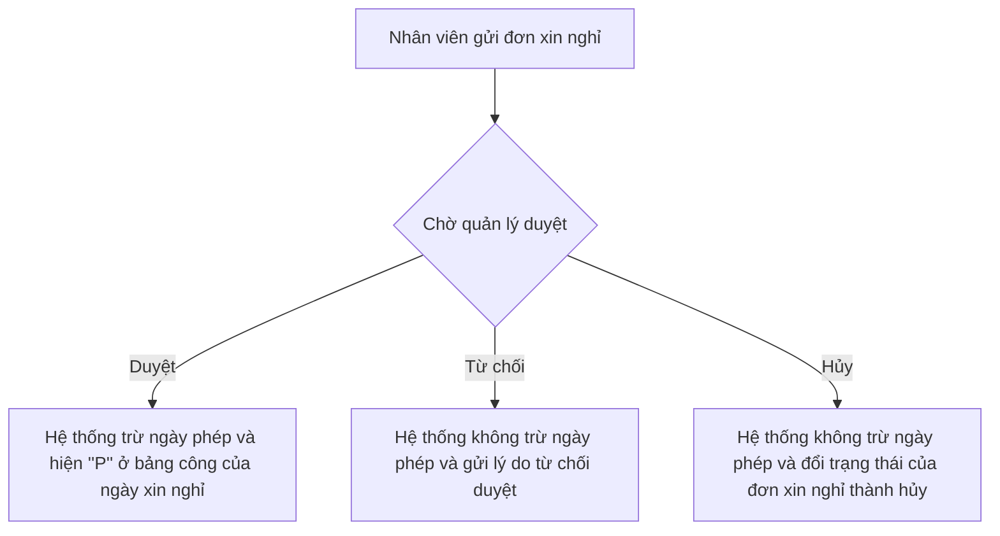
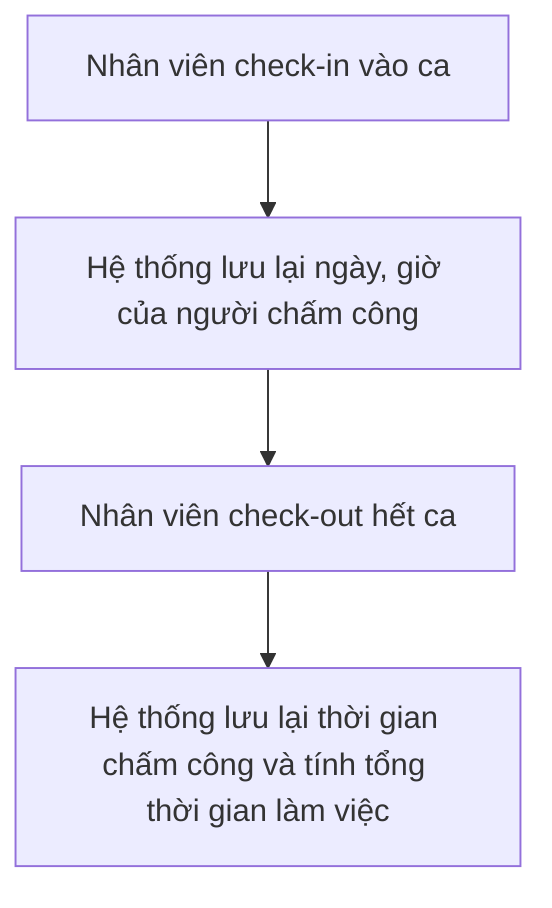

# Business Requirements Document
## Hệ Thống Quản Lý Nhân Sự & Chấm Công
> **Tài liệu đặc tả yêu cầu nghiệp vụ cho phân hệ Quản lý nhân sự, Đăng nhập và Luồng quy trình Nghỉ phép - Chấm công tự động.**
---

## 1. Quy trình xin nghỉ – duyệt và chấm công
1.1 Quy trình xin nghỉ - duyệt 

1.2 Quy trình chấm công

## 2. Danh sách User story
### 2.1 Phần Đăng nhập
#### US_01: Đăng nhập vào hệ thống
- **Là** 1 người dùng (Nhân viên, Quản lý, HR) **Tôi muốn** đăng nhập vào hệ thống bằng Email và mật khẩu cá nhân **Để** tôi có thể truy cập vào hệ thống và sử dụng các trong quyền hạn của tôi

* **Tiêu chí:**
  - **Khi** người dùng nhập Email không tồn tại thì hệ thống sẽ từ chối truy cập.

  - **Khi** người dùng nhập Email tồn tại nhưng sai mật khẩu thì hệ thống sẽ từ chối truy cập.

  - **Khi** người dùng nhập Email có tồn tại và đúng mật khẩu thì hệ thống sẽ duyệt yêu cầu truy cập.

### 2.2 Phần Nhân sự
#### US_02: Quản lý phòng ban
- **Là** 1 HR **Tôi muốn ** được thêm, sửa, xóa phòng ban **Để** có thể kiểm soát, phân chia, cơ cấu công ty 1 cách dễ dàng và chính xác

* **Tiêu chí**
  - **Khi** HR thêm phòng ban mà thiếu thông tin yêu cầu (Mã phòng ban, Tên phòng ban, Lĩnh vực) thì hệ thống sẽ từ chối tạo phòng ban.

  - **Khi** HR thêm phòng ban mà nhập đủ thông tin yêu cầu (Mã phòng ban, Tên phòng ban, Lĩnh vực) thì hệ thống sẽ tạo phòng ban mới và lưu lại. 

  - **Khi** HR muốn sửa phòng ban mà bỏ trống, xóa thông tin yêu cầu (Tên phòng ban, Lĩnh vực) thì hệ thống sẽ từ chối cập nhật thông tin phòng ban.

  - **Khi** HR muốn sửa phòng ban mà đã nhập đầy đủ các thông tin (Tên phòng ban, Lĩnh vực) thì hệ thống sẽ cập nhật thông tin mới của phòng ban và lưu lại hệ thống.

  - **Khi** HR muốn xóa phòng ban mà phòng ban đó vẫn còn nhân sự thì hệ thống sẽ từ chối yêu cầu xóa của HR.

  -**Khi** HR muốn xóa phòng ban mà phòng ban đó không còn nhân sự nào thì hệ thống sẽ xác nhận yêu cầu và xóa phòng ban được chỉ định.

#### US_03: Quản lý nhân sự
  - **Là** 1 HR **Tôi muốn** được thêm,sửa, xem danh sách nhân sự **Để** kiểm soát nhân sự 1 cách chặt chẽ, nắm bắt được thông tin vị trí của nhân sự 1 cách dễ dàng

* **Tiêu chí**
  - **Khi** HR thêm nhân sự nhưng ghi thiếu thông tin yêu cầu thì hệ thống sẽ từ chối yêu cầu thêm nhân sự.

  - **Khi** HR thêm nhân sự và ghi đầy đủ các thông tin yêu cầu thì hệ thống sẽ lưu lại thông tin của nhân sự đó vào tạo ra 1 tài khoản kèm mật khẩu dựa theo thông tin của nhân sự.

  - **Khi** HR sửa thông tin của 1 nhân sự và chỉnh sửa các mục (Phòng ban, chức danh, quản lý trực tiếp ,trạng thái) thì hệ thống sẽ lưu lại và cập nhật thông tin mới cho nhân sự.

  - **Khi** HR xem danh sách nhân sự thì hệ thống sẽ hiện thị ra toàn bộ các nhân sự trực thuộc quyền điều hành của công ty.

#### US_04: Tìm theo tên, lọc theo phòng ban
  - **Là** 1 HR **Tôi muốn** được tìm nhân sự của mình trong danh sách bằng tên và bằng bộ lọc **Để** có thể tìm kiếm nhân sự 1 cách dễ dàng và nhanh chóng
  
* **Tiêu chí**
  - **Khi** HR tìm kiếm 1 nhân sự bằng tên nhưng phần thanh tìm kiếm để trống thì hệ thống sẽ từ chối tìm kiếm và vẫn giữ nguyên toàn bộ danh sách nhân sự.

  - **Khi** HR tìm kiếm 1 nhân sự bằng tên và nhập tên lên thanh tìm kiếm thì hệ thống sẽ tìm tên tương ứng.

  - **Khi** HR chọn phòng ban mà mình muốn xem nhân sự thì hệ thống sẽ hiển thị ra danh sách toàn bộ nhân sự nằm trong phòng ban đó.

### 2.3 Phần chấm công & Nghỉ phép 
#### US_05: Châm công (Check-in, Check-out)
- **Là** 1 Nhân viên **Tôi muốn** có thể Check-in, Check-out **Để** có hệ thống có thể xác nhận chính xác số ngày, thời lượng công của tôi.

* **Tiêu chí**
  - **Khi** Nhân viên Check-in, Check-out hệ thống sẽ lưu lại thời gian mà nhân viên đã Check-in và Check-out và tính thời lượng công của nhân viên trong ngày hôm đó.

#### US_06: Xem bảng công bản thân theo tháng (Nhân viên)
  - **Là** 1 Nhân viên **Tôi muốn** có thể xem được ngày công trong 1 tháng của tôi **Để** có thể nắm bắt được số lượng ngày công thực tế, cũng như ngày vắng và ngày nghỉ phép của tôi.

* **Tiêu chí**
  - **Khi** Nhân viên chọn xem bảng công của bản thân thì hệ thống sẽ hiển thị ra toàn bộ bảng công trong 1 tháng của nhân sự, trong đó sẽ hiển thị toàn bộ ngày công trong tháng, ngày nghỉ phép.

#### US_07: Xem bảng công của toàn bộ công ty (HR)
  - **Là** 1 HR **Tôi muốn** xem được toàn bộ bảng công của toàn bộ công ty **Để** có thể theo dõi tiến trình đi làm của toàn bộ công ty cưng như dựa vào ngày công để có thể tính lương.

* **Tiêu chí**
  - **Khi** HR chọn xem bảng công của toàn bộ nhân viên thì hệ thống sẽ hiển thị ra 1 danh sách ngày công của toàn bộ nhân viên công ty.

#### US_08: Gửi đơn xin nghỉ phép
  - **Là** 1 Nhân viên **Tôi muốn** được quyền gửi đơn xin nghỉ phép **Để** có thể giải quyết công việc cá nhân hoặc nhằm đảo bảo sức khỏe.

* **Tiêu chí**
  - **Khi** Nhân viên chọn ngày gửi đơn xin nghỉ phép, hệ thống sẽ xác nhận đơn nghỉ phép rồi chuyển đến người quản lý của nhân sự đó.

#### US_09: Quản lý đơn xin nghỉ phép của nhân viên
  - **Là** 1 Quản lý **Tôi muốn** có thể duyệt/từ chối đơn xin nghỉ phép của nhân viên **Để** có thể sắp xếp lại công việc cũng như để hệ thống cập nhật được ngày công/

* **Tiêu chí**
  - **Khi** Quản lý từ chối duyệt đơn xin nghỉ phép và điền lý do, hệ thống sẽ gửi lại thông báo từ chói kèm lý do cho nhân sự đó, cũng như sẽ không trừ ngảy quỹ nghỉ của nhân sự.

  - **Khi** Quản lý duyệt đơn xin nghỉ phép, hệ thống sẽ thông báo xác nhận cho nhân sự và sẽ trừ đi 1 ngày trong quỹ nghỉ của nhân viên (12 ngày/năm).