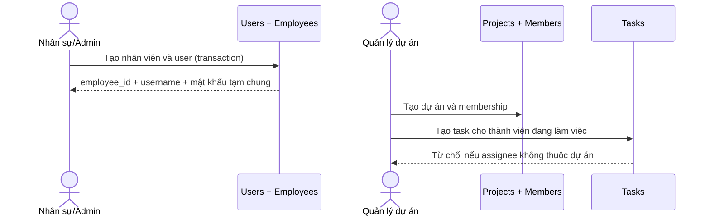
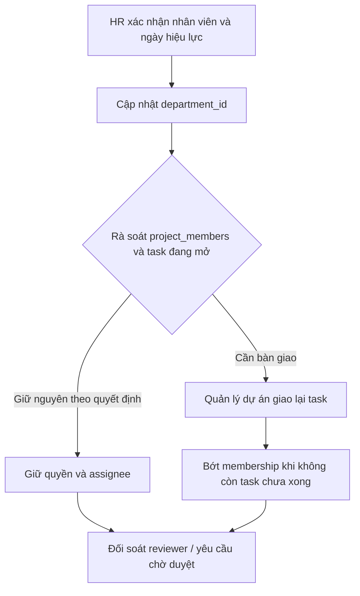
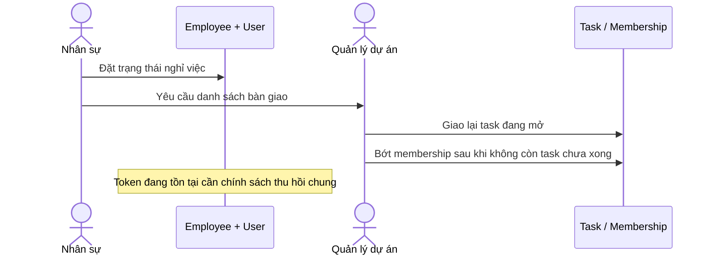

# Luồng nghiệp vụ liên module: Nhân sự ↔ Dự án

> Đây là phân tích hợp đồng giữa các module, không thay thế quy trình HR. Người phụ trách Nhân sự cần xác nhận bước HR, người nhận phê duyệt và cách xử lý hồ sơ trước khi chốt vận hành.

## 1. Tiếp nhận nhân viên → tài khoản → tham gia dự án

### Tiền điều kiện

- Phòng ban đích đã tồn tại.
- Người tạo có quyền quản trị nhân sự.
- Nhân viên chưa có username xung đột.

### Luồng hiện tại

1. API tạo nhân viên sinh username từ tên, tạo user và employee trong cùng transaction.
2. API trả `login_info.default_password` là mật khẩu chung `12345`.
3. Quản lý/Admin tạo dự án, chọn nhân viên đang làm việc làm thành viên; quản lý dự án cũng được thêm vào membership.
4. Người quản lý tạo task và chỉ định một thành viên đang làm việc.

### Hậu điều kiện và rủi ro

- User và employee hoặc cùng được tạo, hoặc transaction rollback.
- Project membership được tạo cùng dự án; task được giao cho thành viên hiện hành.
- Mật khẩu chung đoán được là rủi ro bảo mật. Luồng tạo người dùng và activation thuộc HR/backend tích hợp; không dùng sơ đồ này để phê chuẩn quy trình cấp credential.

### Rollback / khôi phục

- Lỗi trong transaction tạo user/employee: không có bản ghi dở dang theo transaction.
- Lỗi sau khi nhân viên đã được tạo nhưng trước khi đưa vào dự án: giữ hồ sơ nhân viên, không xóa tài khoản tự động; HR xác nhận lại thông tin rồi thử thêm membership.
- Tạo nhầm membership nhưng chưa giao task: quản lý dự án/Admin có thể bớt thành viên. Nếu đã có task chưa xong, cần giao lại trước khi bớt.

## 2. Chuyển phòng ban → rà soát dự án và task

### Tiền điều kiện

- Nhân viên và phòng ban đích tồn tại.
- HR xác nhận ngày hiệu lực và người có quyền thực hiện.

### Luồng hiện tại / điểm cần thống nhất

1. API cập nhật `employees.department_id` cho danh sách nhân viên.
2. `project_members` và `tasks.assignee_id` không tự thay đổi theo phòng ban; quyền dự án dựa vào membership/manager, không dựa trực tiếp vào phòng ban.
3. Reviewer của yêu cầu làm thêm lưu `department_id` lúc gửi; thay đổi phòng ban không tự chuyển reviewer đã ghi nhận.
4. HR và quản lý dự án cần quyết định task/membership cũ có được giữ, chuyển giao hay thu hồi.

### Hậu điều kiện và rollback

- Hậu điều kiện mong muốn: phòng ban cập nhật; các quyền/task được rà soát theo quyết định có người chịu trách nhiệm; yêu cầu đang chờ giữ nguyên người nhận theo snapshot hoặc được chuyển có audit.
- Hiện nhiều nhân viên được chuyển bằng `Promise.all`, không phải một transaction toàn nhóm; một phần có thể đã đổi nếu một thao tác thất bại.
- Nếu có lỗi: kiểm tra từng `employee_id` và phòng ban thực tế, khôi phục các bản ghi đã đổi về phòng cũ theo danh sách đối soát; không chạy lại mù toàn bộ lệnh.

## 3. Nghỉ việc → thu hồi quyền → bàn giao dự án

### Tiền điều kiện

- HR xác nhận trạng thái và thời điểm nghỉ việc.
- Có người tiếp nhận các task/membership cần duy trì.

### Luồng hiện tại / khoảng trống

1. HR cập nhật `employees.status = da_nghi_viec`.
2. Đăng nhập hiện từ chối nhân viên đã nghỉ việc; tuy nhiên middleware JWT chung hiện kiểm tra chữ ký/expiry và dùng role trong token, không truy vấn trạng thái hiện hành cho mọi request.
3. Membership, task được giao và quản lý dự án không tự đóng/chuyển khi đổi trạng thái nhân viên.
4. Giao lại task đang mở trước khi bớt thành viên; API hiện chặn bớt nếu nhân viên còn task chưa xong.

### Hậu điều kiện và rollback

- Hậu điều kiện mong muốn: quyền đăng nhập/API bị thu hồi theo SLA đã quyết định; task đang mở có chủ sở hữu mới hoặc được đưa vào trạng thái chờ phân công; lịch sử người cũ được giữ.
- Không tự xóa employee/user hoặc task. Nếu nghỉ việc bị nhập nhầm, HR có thể khôi phục trạng thái theo quy trình HR; sau đó quản lý xác nhận lại membership và task.
- Cần ghi lại người thực hiện, thời điểm, lý do và quyết định bàn giao để có thể kiểm toán. Hiện các thay đổi HR này chưa có audit trail đầy đủ.

## Các quyết định liên module còn mở

- Ai khởi tạo và xác nhận việc bàn giao task khi chuyển phòng/nghỉ việc?
- Thay đổi phòng ban có hiệu lực ngay hay theo ngày hiệu lực; yêu cầu đang chờ có giữ người duyệt đã chụp lúc gửi không?
- SLA thu hồi JWT sau khi đổi role/nghỉ việc là bao lâu?
- Có cần lịch sử membership và lịch sử phòng ban để báo cáo theo thời điểm không?

## Nguồn đối chiếu

- `backend/src/controllers/userController.js` — tạo nhân viên, cập nhật phòng ban.
- `backend/src/controllers/projectController.js`, `memberController.js`, `taskController.js` — dự án, thành viên, phân công task.
- `backend/src/controllers/authController.js`, `middlewares/authMiddleware.js` — đăng nhập và xác thực token.
- `backend/src/routes/overtimeRoutes.js`, `backend/src/controllers/leaveController.js` — người nhận và trạng thái yêu cầu HR.
