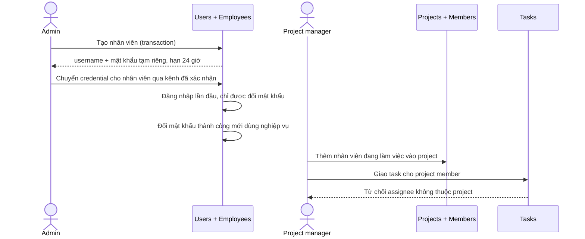
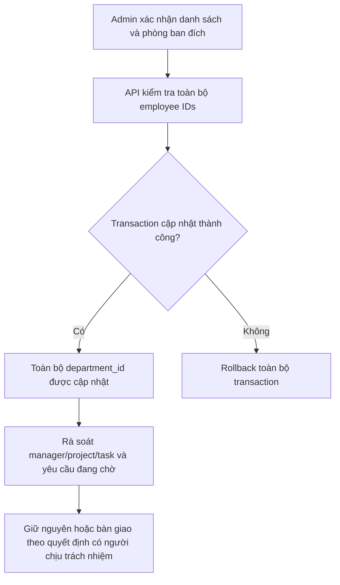
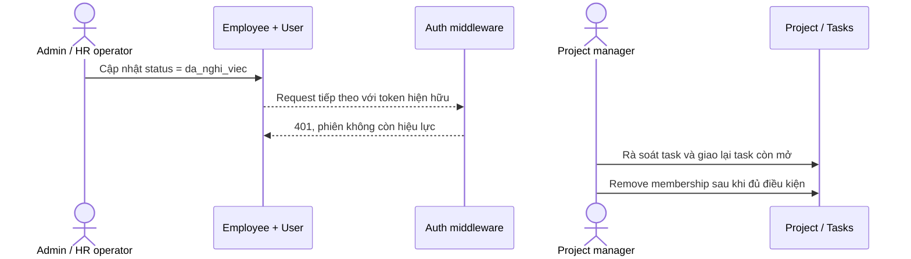

# Luồng nghiệp vụ liên module: Nhân sự ↔ Dự án

> Đối chiếu với code trong checkout `develop` ngày 09/11/2026. Nhãn **Hiện trạng** mô tả code; **Quy tắc đã thống nhất** chỉ dùng cho policy đã có căn cứ; **Đề xuất** và **Cần xác nhận** không được hiểu là hành vi đã triển khai.

## 1. Onboarding: tạo nhân viên → tài khoản → tham gia dự án

### Hiện trạng

1. Chỉ Admin được gọi `POST /api/users/employee-create`. Backend tạo `users` và `employees` trong cùng transaction; username được sinh theo tên và kiểm tra uniqueness.
2. Mật khẩu tạm được tạo ngẫu nhiên riêng cho mỗi tài khoản, có hạn 24 giờ. Tài khoản phải đổi mật khẩu trước khi gọi nghiệp vụ; lần đăng nhập bằng mật khẩu tạm được đánh dấu đã dùng. Admin có thể cấp lại mật khẩu tạm qua endpoint reset.
3. API tạo project thêm project manager vào membership. Người quản lý thêm các nhân viên đang làm việc vào project.
4. Khi tạo/giao lại task, assignee phải là nhân viên đang làm việc và là thành viên của project.
5. Nhân viên mới không tự động được thêm vào project chỉ vì thuộc một phòng ban.

Nguồn: `backend/src/routes/userRoutes.js`, `userController.createUser`, `authController.login`, `authMiddleware.verifyToken`, `projectController.createProject`, `memberController`, `taskController`, `taskDetailsController`.

### Hậu điều kiện, rollback và khoảng trống

- Transaction đảm bảo user và employee cùng được tạo hoặc cùng rollback.
- Nếu lỗi sau khi tạo nhân viên nhưng trước khi thêm vào project, tài khoản vẫn tồn tại; thử lại thao tác membership sau khi xác nhận hồ sơ, không tạo trùng tài khoản.
- **Rủi ro hiện tại:** `/api/users/employee-list` chỉ yêu cầu đăng nhập và trả danh sách có dữ liệu cá nhân. Cần giới hạn trường và phạm vi theo vai trò trước khi dùng endpoint này làm danh bạ onboarding.
- **Cần xác nhận:** kênh gửi mật khẩu tạm, người chịu trách nhiệm giao credential, và yêu cầu activation thay cho mật khẩu tạm.

## 2. Chuyển phòng ban → rà soát project/task

### Hiện trạng

1. Admin gọi `PUT /api/users/update-department` để cập nhật phòng ban cho nhiều nhân viên. Backend kiểm tra danh sách rồi thực hiện `employees.updateMany` trong một transaction; nếu transaction lỗi, cả nhóm cập nhật rollback.
2. Hệ thống hiện chỉ cập nhật `employees.department_id`, không lưu ngày hiệu lực/lịch sử phòng ban.
3. `project_members`, task assignee và `projects.manager_id` không tự thay đổi theo phòng ban. Quyền project dựa vào membership, `manager_id`, role hiện hành và các kiểm tra ở API, không suy ra từ phòng ban.
4. Người nhận yêu cầu làm thêm được lưu tại thời điểm gửi; chuyển phòng không tự chuyển các yêu cầu đang chờ.

Nguồn: `backend/src/routes/userRoutes.js`, `userController.updateEmployeesDepartment`, `schema.prisma` (`employees`, `project_members`, `projects`), `overtimeController`.

### Hậu điều kiện, rollback và quyết định cần xác nhận

- Sau thành công, toàn bộ danh sách có phòng ban mới; quyền và assignment project giữ nguyên cho đến khi được xử lý riêng.
- Nếu request timeout và không rõ transaction đã commit chưa, đọc lại `department_id` của đúng danh sách nhân viên trước khi chạy lại; không suy đoán dựa trên response bị mất.
- **Đề xuất:** lưu ngày hiệu lực và lịch sử chuyển phòng; rà soát project manager, membership, task assignee và approver đang chờ như checklist nghiệp vụ, không tự động đổi assignment.
- **Cần xác nhận:** ngày hiệu lực có thể trong tương lai không; ai phê duyệt chuyển phòng; approver đã chụp lúc gửi có được giữ nguyên không; ai quyết định bàn giao task/project.

## 3. Offboarding: nghỉ việc → thu hồi quyền → bàn giao project

### Hiện trạng

1. Admin cập nhật trạng thái employee qua API user. Khi trạng thái thành `da_nghi_viec`, transaction xóa liên kết department manager nếu trỏ tới người đó và hạ role user khỏi `manager` khi phù hợp.
2. `verifyToken` đọc role và trạng thái employee hiện tại từ DB ở mỗi request; tài khoản `da_nghi_viec` bị từ chối, nên quyền API bị thu hồi ngay ở request kế tiếp, kể cả token chưa hết hạn.
3. Việc nghỉ không tự xóa account, project membership hay task. Task còn mở phải được quản lý/Admin giao lại; API không cho remove member khi họ còn task chưa hoàn tất.
4. Khi đổi trạng thái trở lại active, hệ thống không tự khôi phục liên kết department manager, membership hay task đã được xử lý.

Nguồn: `backend/src/routes/userRoutes.js`, `userController.updateUser`, `authMiddleware.verifyToken`, `memberController.removeMember`, `taskDetailsController.updateTaskDetails`.

### Hậu điều kiện, rollback và khoảng trống

- Quyền gọi API bị thu hồi theo kiểm tra DB ở request tiếp theo; không đợi JWT hết hạn.
- Nếu nhập nghỉ việc nhầm, Admin có thể cập nhật trạng thái employee, nhưng cần chủ động rà soát lại manager relationship, membership và assignment; đây chưa phải luồng rehire hoàn chỉnh.
- Không xóa account/task tự động. Ghi lại đối soát bàn giao ngoài hệ thống hiện là quy trình vận hành; code chưa có audit log đầy đủ cho thay đổi role/phòng ban/offboarding.
- **Đề xuất:** bổ sung checklist bàn giao trước/sau khi đổi trạng thái và lưu người thực hiện, thời điểm, lý do cùng các assignment được bàn giao.
- **Cần xác nhận:** có bắt buộc bàn giao xong trước khi cho nghỉ việc không; ai được phép đánh dấu hoàn tất bàn giao; thời hạn giữ dữ liệu và xử lý hồ sơ sau nghỉ việc.

## Luồng liên quan: duyệt nghỉ phép

- API chặn người gửi tự duyệt đơn. Đơn gửi tới quản lý phòng ban hợp lệ, nếu không có thì fallback tới Admin đang hoạt động theo truy vấn hiện hành.
- Quyết định duyệt/từ chối hiện cập nhật trạng thái có điều kiện để tránh duyệt trùng; model chưa lưu đầy đủ người duyệt, thời điểm và lý do từ chối.
- Hủy đơn hiện là xóa cứng và thao tác đọc trạng thái rồi xóa chưa nằm trong một transaction/conditional delete thống nhất; có race có thể xóa đơn vừa được duyệt.

Nguồn: `backend/src/controllers/leaveController.js`, `backend/src/routes/leaveRoutes.js`, `backend/prisma/schema.prisma` (`Day_off_requests`).

## Quyết định liên module còn mở

1. Quy trình và kênh cấp credential tạm cho nhân viên mới.
2. Hiệu lực và audit của thay đổi phòng ban; xử lý project/task/reviewer đang tồn tại.
3. Quy trình bàn giao bắt buộc khi nghỉ việc và khi tái kích hoạt.
4. Quyền truy cập employee directory và các trường thông tin được hiển thị theo vai trò.
5. Audit cho phê duyệt nghỉ phép, từ chối và hủy đơn.

Các quyết định nghiệp vụ trên cần người phụ trách Nhân sự và chủ nghiệp vụ xác nhận; nội dung “Đề xuất” không đại diện cho quyết định đã thống nhất.
