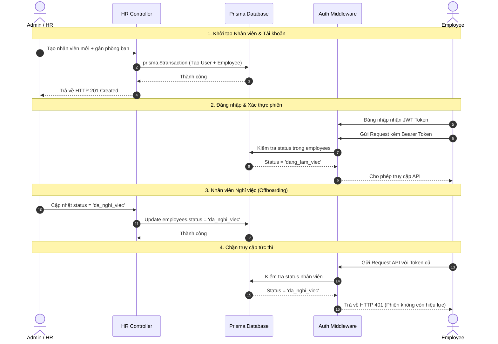

# Quy trình Nghiệp vụ Xuyên suốt các Module (Cross-Module Workflows)

## 1. Sơ đồ Luồng Vòng đời Nhân viên và Xác thực Hệ thống (Mermaid)

---

## 2. Invariants, Rủi ro Dữ liệu & Case Phê duyệt của Module Nhân sự

### A. 5 Invariant Nghiệp vụ (Quy tắc bất biến bắt buộc bảo vệ)
1. **Liên kết Một-Một giữa User và Employee:** Mỗi tài khoản đăng nhập (`users`) chỉ được phép liên kết với duy nhất một hồ sơ nhân sự (`employees`).
2. **Chặn tuyệt đối tài khoản nghỉ việc:** Nhân sự đã ở trạng thái `status = 'da_nghi_viec'` không bao giờ được phép đăng nhập hoặc gọi bất kỳ API nghiệp vụ nào trên hệ thống.
3. **Bảo vệ toàn vẹn phòng ban:** Không được phép xóa phòng ban (`departments`) nếu vẫn còn nhân viên trực thuộc bên trong (`employees.length > 0`).
4. **Tính hợp lệ của Quản lý:** Trưởng phòng (`manager_id`) bắt buộc phải là một nhân sự đang làm việc (`status = 'dang_lam_viec'`), không được phép chỉ định nhân viên đã nghỉ việc làm quản lý.
5. **Tính nguyên tử khi thay đổi hàng loạt (Atomicity):** Mọi thao tác thay đổi cơ cấu lớn (như chuyển phòng ban hàng loạt) phải được thực hiện trong transaction để đảm bảo thành công toàn bộ hoặc hoàn tác (`rollback`).

### B. 3 Rủi ro Dữ liệu (Data Risks)
1. **Lệch vai trò (Role Sync Mismatch):** Nhân viên bị bãi nhiệm hoặc thuyên chuyển khỏi vị trí Trưởng phòng nhưng tài khoản hệ thống (`users.role`) vẫn bị kẹt ở quyền `'manager'`, dẫn đến việc dư thừa quyền hạn.
2. **Dữ liệu mồ côi khóa ngoại (Orphaned Foreign Keys):** Do sơ suất xóa trực tiếp bản ghi trong database thay vì dùng cơ chế Soft Delete, làm mất tính liên kết tham chiếu của dữ liệu chấm công hoặc dự án.
3. **Xử lý đồng thời (Race Condition):** Hai quản trị viên cùng thực hiện thao tác gán hoặc thay đổi Trưởng phòng cho cùng một phòng ban tại một thời điểm, dẫn đến xung đột ghi đè dữ liệu.

### C. 3 Case cần Phê duyệt (Approval Workflows)
1. **Phê duyệt Đơn nghỉ phép / Đơn từ:** Nhân viên tạo yêu cầu -> Trưởng phòng trực tiếp xét duyệt -> Hệ thống ghi nhận vào bảng chấm công và quỹ phép.
2. **Phê duyệt Bổ nhiệm hoặc Miễn nhiệm Trưởng phòng:** Đề xuất thăng chức/điều chuyển -> Cấp quản lý cấp cao/Admin phê duyệt -> Hệ thống tự động đồng bộ thay đổi `role` của tài khoản.
3. **Phê duyệt Mở lại tài khoản / Tái tuyển dụng (Rehire):** Khi nhân sự cũ quay lại làm việc, HR gửi yêu cầu -> Admin phê duyệt kích hoạt lại trạng thái hoạt động trên hệ thống.
