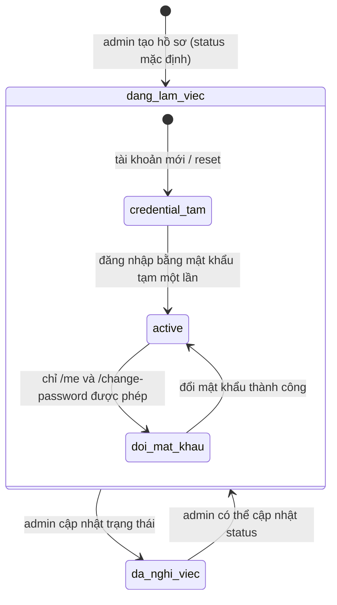

# Phân tích domain Nhân sự — hiện trạng, rủi ro và quyết định cần duyệt

> Đối chiếu với code trong checkout `develop` ngày 09/11/2026. Người phụ trách HR cần xác nhận các chính sách được đánh dấu **Cần duyệt**. Nội dung này không tuyên bố thay mặt HR phê chuẩn quy chế công ty.

## 1. Thực thể và nguồn dữ liệu

| Thực thể | Dữ liệu/quan hệ hiện tại | Nguồn |
|---|---|---|
| Tài khoản | `users.user_id`, `username` unique, `role`, password hash và cờ/thời hạn đổi mật khẩu tạm. | `schema.prisma: users`; `userController.createUser/resetTemporaryPassword`. |
| Hồ sơ nhân viên | `employees.employee_id` là khóa nghiệp vụ; `user_id` unique; có `department_id`, `position`, `status`, liên hệ và ngày vào làm. | `schema.prisma: employees`. |
| Phòng ban/quản lý | `departments.manager_id` là nullable FK tới `employees.employee_id`; cột hiện hành không tên `managment`. Schema còn `employees.manage_by` dạng chuỗi legacy, không được controller hiện hành sử dụng. | `schema.prisma: departments/employees`; `departmentController.js`; `rg manage_by` chỉ thấy schema và một chú thích. |
| Chấm công/lương | Attendance unique theo nhân viên/ngày; payroll snapshot unique theo nhân viên/tháng. | `schema.prisma: attendances/payrolls`. |
| Đơn nghỉ | Lưu người gửi, người nhận, khoảng ngày, lý do, trạng thái; chưa có trường reviewer/time/rejection note. | `schema.prisma: Day_off_requests`; `leaveController.js`. |

## 2. Quyền API hiện tại

Đây là contract code hiện hành, không phải ma trận quyền được chủ HR phê chuẩn.

| API/hành động | Employee | Manager | Admin | Bằng chứng |
|---|---|---|---|---|
| `GET /api/users/me` | Được xem hồ sơ gắn với user hiện tại | Tương tự | Tương tự | `userRoutes.js`, `userController.getMyProfile`. |
| `PATCH /api/users/me` | Sửa các trường allowlist của hồ sơ cá nhân | Tương tự | Tương tự | `profileController.updateMyProfile`, `profileRules.js`. |
| `GET /api/users/employee-list` | Được gọi nếu đã đăng nhập | Được gọi nếu đã đăng nhập | Được gọi nếu đã đăng nhập | Route chỉ gắn `verifyToken`, không có `authorizeRoles`; `getUsers` trả toàn bộ employee rows và include username/role/department. |
| Tạo/sửa nhân viên, reset password, chuyển phòng hàng loạt | 403 | 403 | Được gọi | `userRoutes.js` gắn `authorizeRoles('admin')`. |
| Danh sách phòng ban | Bất kỳ token hợp lệ | Bất kỳ token hợp lệ | Bất kỳ token hợp lệ | `departmentRoutes.js`; cần kiểm tra riêng mức dữ liệu trả về khi điều chỉnh chính sách HR. |
| Tạo/sửa/xóa phòng ban và gán manager | 403 | 403 | Được gọi | `departmentRoutes.js`. |
| Duyệt đơn nghỉ | Không có quyền nếu không phải manager/admin; không được tự duyệt | Chỉ nếu là người nhận đã ghi trên đơn | Admin có thể xử lý đơn chờ | `leaveController.reviewLeaveRequest`. |

**Rủi ro riêng tư đang có:** `/api/users/employee-list` không giới hạn role/phạm vi và `getUsers` không dùng `select` allowlist cho `employees`, nên response chứa cả dữ liệu liên hệ/ngày sinh và các trường hồ sơ. Đây là quan sát code, không phải quyết định rằng mọi nhân viên được phép xem PII. **Đề xuất:** HR/chủ dữ liệu chốt nhóm trường tối thiểu và quyền xem trước khi thay đổi API.

## 3. Invariants hiện được bảo vệ ở code

1. Một `users.username` không trùng; mỗi hồ sơ employee gắn tối đa một user (`@@unique`). Nguồn: `schema.prisma: users/employees`.
2. Employee thuộc một department tồn tại qua FK; manager phòng ban nếu có phải tham chiếu employee tồn tại. Nguồn: `schema.prisma: departments/employees`.
3. Tạo user và employee đi cùng một transaction; tài khoản mới nhận mật khẩu tạm ngẫu nhiên riêng, hết hạn sau 24 giờ và bị buộc đổi trước khi dùng API nghiệp vụ. Nguồn: `userController.createUser`, `authController.login`, `authMiddleware.verifyToken`.
4. Middleware xác thực chữ ký JWT, sau đó đọc role/status hiện hành từ DB; nhân viên `da_nghi_viec` bị từ chối. Nguồn: `authMiddleware.verifyToken`.
5. Phép năm được tính theo ngày làm việc Thứ 2–Thứ 6; ngày đã có đơn active (chờ/đã duyệt) không được xin lại; tổng đã dùng/đăng ký bị chặn ở hằng số 12 ngày. Nguồn: `leaveController.MAX_LEAVE_DAYS`, `reservedWorkingDates`, `createLeaveRequest`.
6. Đơn nghỉ không thể tự duyệt; request review chỉ cập nhật nếu status vẫn đang chờ. Nguồn: `leaveController.reviewLeaveRequest`.
7. Chuyển phòng hàng loạt kiểm tra toàn bộ ID và cập nhật trong một transaction; đây không còn là một chuỗi `Promise.all` ghi độc lập. Nguồn: `userController.updateEmployeesDepartment`.
8. Khi admin đặt employee thành `da_nghi_viec`, API transaction xóa liên kết manager khỏi các department và hạ role `manager` về `employee`; rehire có thể đặt lại status qua API nhưng không tự khôi phục manager assignment. Nguồn: `userController.updateUser`.

## 4. Vòng đời tài khoản/nhân viên

Sơ đồ thể hiện khả năng kỹ thuật, không khẳng định đây là quy trình tuyển dụng/tái tuyển dụng đã được duyệt. API không có event riêng cho tái tuyển dụng, không ghi lịch sử ngày hiệu lực; khi nghỉ việc `manager_id` bị xóa nên khôi phục status không tự khôi phục chức vụ quản lý.

## 5. Quy tắc lương/chấm công đang chạy

Không cộng ngày phép vào tổng ngày công sau đó lại trừ ngày vắng. Backend phân loại mỗi ngày một lần:

1. `standard_days` = số ngày Thứ 2–Thứ 6 trong toàn tháng; chưa loại ngày lễ và chưa điều chỉnh theo ngày tuyển dụng.
2. Với ngày đến hiện tại, `payrollDays` gọi `classifyDay`. `off_days` tăng 1 nếu status là `absent`, `missing`, `conflict`, `late_early` hoặc `not_employed`. `leave`, `complete`, `late`, `early`, `in_progress`, `waiting` không tăng `off_days`.
3. `deduction` = `off_days × base_salary / standard_days`, làm tròn theo nghìn; `net_salary` = tối thiểu 0 của `base_salary - deduction + extra`, làm tròn theo nghìn.
4. Ngày nghỉ đã duyệt được phân loại `leave`, nên không bị coi là vắng không phép và cũng không cộng thành ngày công trong công thức này.

Nguồn: `backend/src/utils/payrollRules.js` (`workingDates`, `payrollDays`, `payrollAmounts`) và `attendanceRules.js` (`classifyDay`). Đây là công thức code hiện hành; cần HR xác nhận chính sách trả lương cho phép có lương, ngày vào làm giữa tháng, đi muộn/ra sớm một chiều và ngày lễ trước khi xem là quy định chính thức.

## 6. Rủi ro dữ liệu và vận hành

1. **Lộ PII qua danh sách nhân viên:** route chỉ cần token và trả hồ sơ nhiều trường. Nguồn: `userRoutes.js`, `userController.getUsers`. Cần phân loại trường và quyền truy cập.
2. **Thiếu lịch sử tổ chức:** chuyển phòng/chức vụ/manager ghi đè thông tin hiện tại; không có effective date/history. Nguồn: `userController.updateUser/updateEmployeesDepartment`, `schema.prisma: employees`.
3. **Offboarding chưa bàn giao project:** status đổi sẽ khóa token nhưng không giao lại task, xóa membership hoặc chọn người thay thế. Nguồn: `userController.updateUser`, `project_members`, `tasks`; `memberController.removeMember` yêu cầu giao lại task chưa xong trước khi xóa membership.
4. **Hủy đơn nghỉ có race và mất lịch sử:** `cancelLeaveRequest` đọc status rồi hard-delete riêng; reviewer có thể xử lý giữa lúc đọc và xóa. Đơn không lưu trạng thái hủy/reviewer/time. Nguồn: `leaveController.cancelLeaveRequest/reviewLeaveRequest`, schema `Day_off_requests`.
5. **Manager department và role có thể lệch khi chuyển phòng:** bulk transfer chỉ cập nhật `employees.department_id`, không chuyển `departments.manager_id` hoặc cập nhật role. Nguồn: `userController.updateEmployeesDepartment`.
6. **Hợp đồng đếm đơn nghỉ chờ duyệt không khớp:** frontend gọi `/api/leave-requests/pending-count`, backend hiện dùng `/api/leaves` và không khai báo route đó. Nguồn: `frontend/src/services/leaveApi.js`, `backend/src/server.js`, `backend/src/routes/leaveRoutes.js`.

## 7. Các case cần HR/chủ nghiệp vụ duyệt

1. `/api/users/employee-list`: nhân viên, manager và admin được xem những trường hồ sơ nào? Hiện code cấp cùng endpoint cho mọi token.
2. Nghỉ phép: có giữ giới hạn 12 ngày; ngày chờ duyệt có trừ quota; người nhận là manager phòng ban, fallback admin đầu tiên; một người duyệt đủ không?
3. Hủy đơn: có cần trạng thái `da_huy`, lý do/người/thời điểm hủy và audit? Nếu có, không nên hard-delete.
4. Chuyển phòng: ngày hiệu lực, quyền lợi/quản lý, manager_id, membership/task và đơn đang chờ được xử lý ra sao?
5. Offboarding/rehire: ai bàn giao task; có giữ project access lịch sử; role và manager assignment được khôi phục bằng bước nào?
6. Payroll: ngày lễ, ngày vào làm giữa tháng, phép có lương, đi muộn/ra sớm một chiều và quy tắc làm tròn được xác nhận ra sao?

## 8. Nguồn code chính

- `backend/prisma/schema.prisma` — `users`, `employees`, `departments`, `Day_off_requests`, `attendances`, `payrolls`.
- `backend/src/routes/userRoutes.js`, `departmentRoutes.js`, `leaveRoutes.js`.
- `backend/src/controllers/userController.js`, `profileController.js`, `departmentController.js`, `leaveController.js`.
- `backend/src/middlewares/authMiddleware.js`, `backend/src/config/env.js`.
- `backend/src/utils/attendanceRules.js`, `payrollRules.js`, `profileRules.js`.
