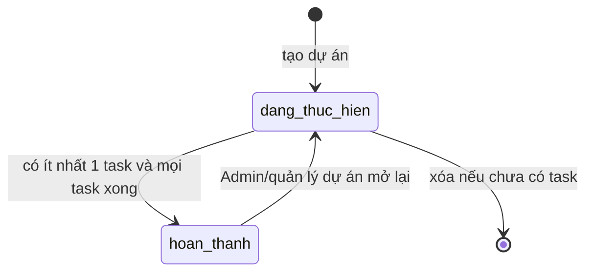
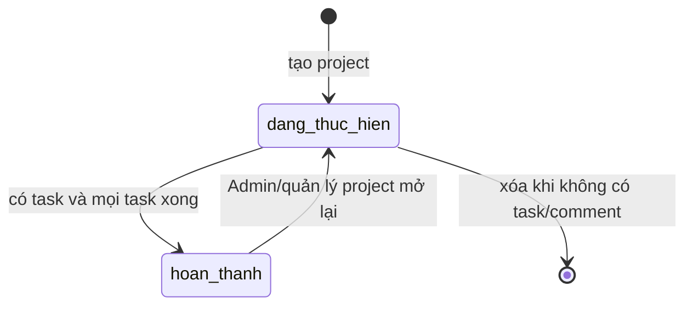
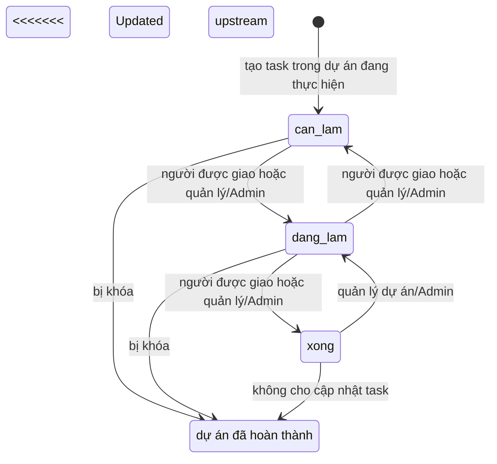

# Phân tích nghiệp vụ Dự án / Task

## Phạm vi và thuật ngữ

<<<<<<< Updated upstream
- **Dự án** là phạm vi công việc có mã, tên, thời hạn, quản lý và thành viên.
- **Quản lý dự án** là nhân viên tham chiếu bởi `projects.manager_id`; khác với vai trò tài khoản `manager`.
- **Thành viên dự án** là bản ghi `project_members`; người được giao task phải là thành viên đang làm việc.
- **Task** có trạng thái `can_lam`, `dang_lam`, `xong`, người giao, người thực hiện, ưu tiên và hạn chót.

## Invariants cần giữ

1. `projects.start_date <= projects.end_date`; dự án mới không kết thúc trước ngày hiện tại.
2. Mỗi cặp dự án/nhân viên chỉ có một membership; quản lý dự án được tự thêm vào danh sách thành viên khi tạo dự án.
3. Người được giao task phải là thành viên dự án và đang làm việc. Backend kiểm tra điều này khi tạo task và khi đổi người thực hiện.
4. Hạn task không được sau `project.end_date`, nhưng hiện chưa chặn hạn trước `project.start_date` trong create/update. `updateProject` chỉ kiểm tra deadline lớn nhất so với ngày kết thúc mới, chưa kiểm tra deadline nhỏ nhất so với ngày bắt đầu mới.
5. Chỉ Admin hoặc tài khoản vai trò `manager` quản lý đúng dự án được tạo/sửa/xóa dự án, quản lý thành viên, tạo task và sửa chi tiết task.
6. Nhân viên chỉ đọc dự án/task mà họ tham gia; quản lý có thể đọc dự án mình quản lý; Admin đọc toàn công ty.
7. Thành viên chỉ đổi trạng thái task mình được giao theo bước cho phép; quản lý đúng dự án/Admin có thể đổi task qua trạng thái kề.
8. Không hoàn tất dự án khi chưa có task hoặc còn task chưa `xong`; dự án hoàn tất không nhận task mới, sửa task hay đổi trạng thái task.
9. Không thể bớt quản lý dự án khỏi membership; không thể bớt thành viên còn task chưa hoàn tất được giao cho họ.
10. Xóa dự án hiện chỉ cho phép khi dự án chưa có task.

Các invariants 4 và các quyết định mở lại dự án cần được khóa bằng test/tài liệu nghiệp vụ; việc kiểm tra hiện trạng không thay thế nguồn quyết định backend.

## State diagram: dự án



`hoan_thanh` khóa tạo/sửa task và đổi trạng thái task. Xóa/mở lại dự án vẫn là thao tác riêng có quyền; cần giữ thống nhất nếu thay policy lưu lịch sử.
=======
- **Dự án** có mã, thời hạn, trạng thái, quản lý (employee) và danh sách thành viên.
- **Quản lý dự án** là `projects.manager_id`; vai trò tài khoản `manager` là quyền hệ thống và không tự cấp quyền quản lý mọi project.
- **Task** thuộc một project, có người thực hiện, người tạo, deadline, độ ưu tiên và trạng thái.

## Invariants

1. Ngày kết thúc project không trước ngày bắt đầu; project mới không có ngày kết thúc trước hôm nay.
2. Một nhân viên chỉ có một membership trong cùng project; quản lý được thêm làm thành viên lúc tạo project.
3. Người được giao task phải là thành viên project đang làm việc.
4. `project.start_date <= task.due_date <= project.end_date`. Backend và frontend hiện kiểm tra hai đầu; đổi thời hạn project bị từ chối nếu deadline task nằm ngoài khoảng mới.
5. Ghi project chỉ dành cho Admin hoặc tài khoản manager đang quản lý đúng project; quản lý thành viên/task theo cùng phạm vi.
6. Nhân viên chỉ đọc project/task họ tham gia; quản lý được đọc project mình quản lý; Admin đọc toàn công ty.
7. Thành viên chỉ đổi trạng thái task mình được giao theo các bước hợp lệ; quản lý dự án/Admin có quyền chuyển trạng thái kề cho task.
8. Project chỉ hoàn tất khi có task và mọi task đều `xong`; project hoàn tất chặn tạo/sửa task và thay trạng thái task.
9. Không thể bớt project manager khỏi membership hoặc bớt member còn task chưa xong được giao cho họ.
10. Chỉ xóa project không có task hoặc comment; thao tác xóa DB xong mới dọn thư mục attachment của đúng project. Scanner orphan chạy dry-run mặc định.
11. Comment được phép trên project hoàn tất; upload/delete attachment và ghi task thì không. Đây là policy hiện tại theo API.
12. Tạo comment kiểm tra quyền trong transaction và khóa membership bằng `FOR SHARE`, tránh ghi sau khi quyền thành viên bị thu hồi.

## State diagram: project



Project hoàn tất cho phép comment và đọc attachment hiện có; khóa upload/delete attachment, sửa task và đổi trạng thái task.
>>>>>>> Stashed changes

## State diagram: task



Backend chỉ cho chuyển sang cột kề. Nhân viên được giao không thể kéo task từ `xong` lùi lại; quản lý/Admin có thể kéo task về trạng thái kề.

## Ma trận quyền hiện tại

| Hành động | Nhân viên thành viên | Quản lý dự án (vai trò manager, đúng manager_id) | Admin | Người ngoài dự án |
|---|---:|---:|---:|---:|
| Xem dự án/task | Có | Có | Có | Không |
| Đổi trạng thái task được giao | Có, theo bước cho phép | Có | Có | Không |
| Đổi trạng thái task người khác | Không | Có, theo bước cho phép | Có, theo bước cho phép | Không |
| Tạo task / sửa task | Không | Có | Có | Không |
| Thêm/bớt thành viên | Không | Có | Có | Không |
| Sửa/xóa/hoàn tất/mở lại dự án | Không | Có | Có | Không |
| Bình luận dự án/task | Thành viên theo endpoint | Quản lý có quyền truy cập theo endpoint | Có | Không |

Vai trò `manager` không tự cấp quyền với mọi dự án. Admin được phân biệt riêng. Một nhân viên là `manager_id` nhưng có role tài khoản employee có thể đọc dự án theo nhánh manager trong truy vấn list, song hàm quản lý ghi yêu cầu role `manager` hoặc `admin`; cần quyết định liệu đây là dữ liệu hợp lệ hay inconsistency cần xử lý.

## Rủi ro dữ liệu cụ thể

1. **Deadline ngoài khoảng dự án:** create/update task không kiểm tra ngày bắt đầu. Sửa khoảng thời gian dự án không kiểm tra task nằm trước ngày bắt đầu mới. Dữ liệu hiện hữu cũng cần truy vấn kiểm kê trước khi áp quy tắc.
2. **Assignee không được ràng buộc bằng DB với membership:** controller kiểm tra ở luồng chuẩn, nhưng ràng buộc FK chỉ bảo đảm nhân viên tồn tại. Script/import hoặc luồng ghi mới có thể tạo task giao cho người ngoài dự án.
3. **Bớt thành viên làm mất lịch sử tham gia:** `removeMember` xóa dòng membership sau khi task chưa hoàn tất đã được giao lại; không có `left_at`/lịch sử membership.
4. **Role token cũ và thay đổi nhân sự:** middleware hiện dùng role trong JWT đến khi token hết hạn; thay đổi role/trạng thái HR không được phản ánh đồng nhất ở mọi endpoint.

## Câu hỏi cần chủ nghiệp vụ quyết định

1. Khi chuyển một nhân viên sang phòng ban khác, membership và task thuộc dự án cũ giữ nguyên, chuyển theo phòng ban, hay yêu cầu quản lý dự án phân công lại?
2. Có cho phép hoàn tất dự án có task bị hủy/đóng theo trạng thái khác ngoài `xong` không? Hiện code yêu cầu tất cả task đúng trạng thái `xong`.
3. Ai được mở lại dự án đã hoàn thành, và có yêu cầu ghi lý do/mốc audit hay không?
4. Có cho xóa dự án rỗng nhưng đã có bình luận/attachment không? Cần chính sách lưu trữ lịch sử trước khi quyết định xóa cứng.
5. Task có được phép có deadline vào cuối tuần/ngày lễ, và khi đổi ngày dự án, deadline ngoài khoảng sẽ bị từ chối, yêu cầu sửa task, hay tự điều chỉnh?
=======
    [*] --> can_lam: tạo trong project đang thực hiện
    can_lam --> dang_lam: người được giao hoặc quản lý/Admin
    dang_lam --> can_lam: người được giao hoặc quản lý/Admin
    dang_lam --> xong: người được giao hoặc quản lý/Admin
    xong --> dang_lam: quản lý project/Admin
    hoan_thanh_du_an: project hoàn tất, task bị khóa
```

Backend chỉ chấp nhận chuyển tới trạng thái liền kề. Nhân viên được giao không tự kéo task đã xong lùi lại.

## Ma trận quyền hiện tại

| Hành động | Nhân viên là member | Manager đúng `manager_id` | Admin | Ngoài project |
|---|---:|---:|---:|---:|
| Đọc project/task | Có | Có | Có | Không |
| Đổi trạng thái task được giao | Có, theo bước | Có | Có | Không |
| Đổi trạng thái task người khác | Không | Có, theo bước | Có, theo bước | Không |
| Tạo/sửa task, quản lý member | Không | Có | Có | Không |
| Sửa/xóa/hoàn tất/mở lại project | Không | Có | Có | Không |
| Comment project/task | Có theo quyền truy cập | Có theo quyền truy cập | Có | Không |
| Upload/delete attachment project hoàn tất | Không | Không | Không | Không |

## Rủi ro và câu hỏi cần chủ nghiệp vụ quyết định

1. **Ràng buộc assignee:** membership được kiểm tra trong controller nhưng DB FK chỉ đảm bảo nhân viên tồn tại; cần xác định có cần constraint/trigger để bảo vệ luồng import hoặc script hay không.
2. **Lịch sử thành viên:** bớt member xóa membership. Có cần lưu `joined_at/left_at` để audit và tái dựng báo cáo lịch sử không?
3. **Ngày project đổi:** code từ chối đổi khoảng thời gian nếu task nằm ngoài khoảng mới; nghiệp vụ có muốn cho phép quản lý sửa task trước, hay muốn workflow điều chỉnh đồng loạt?
4. **Mở lại project:** ai được mở, có cần lý do và audit event không?
5. **Project rỗng có comment:** API chặn xóa để bảo toàn lịch sử comment; chủ sản phẩm cần quyết định có quy trình archive/soft-delete không.
6. **Hiệu suất:** thống kê hiện dựa vào completed_at/deadline và trạng thái; cần chuẩn hóa cách xử lý đổi deadline, chuyển assignee, task chưa đến hạn trước khi dùng đánh giá nhân sự.

## Rủi ro dữ liệu cần kiểm tra

- Attendance chưa có unique `(employee_id, date)` trong Prisma schema; code khóa advisory nhưng DB chưa là lớp bảo vệ cuối.
- Task có FK riêng cho project/assignee nhưng không có khóa ngoại tổng hợp bắt assignee nằm trong membership của project.
- Membership bị xóa khi rời project, làm mất lịch sử tham gia.
>>>>>>> Stashed changes
