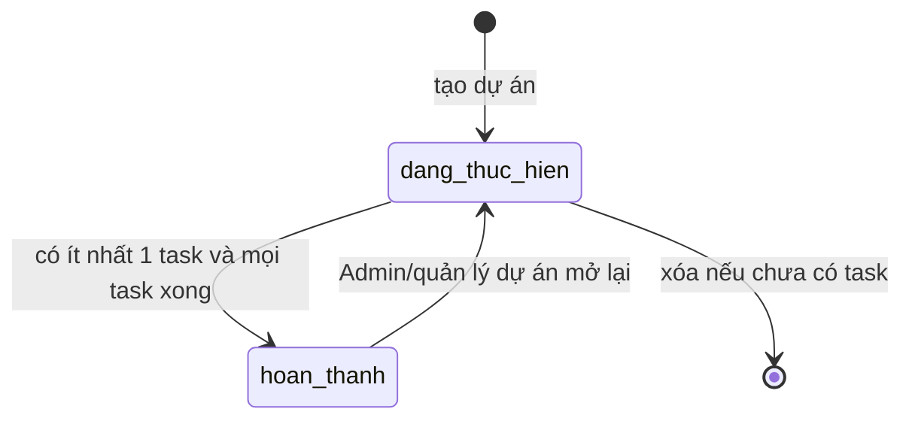
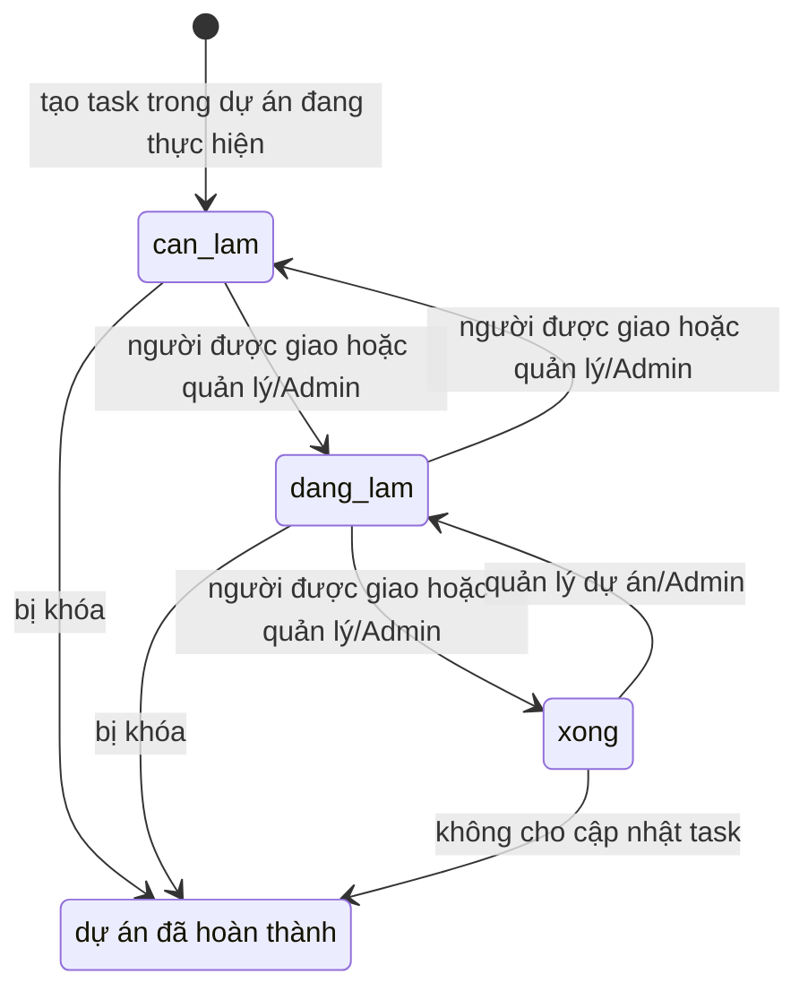

# Phân tích nghiệp vụ Dự án / Task

## Phạm vi và thuật ngữ

- **Dự án** là phạm vi công việc có mã, tên, thời hạn, quản lý và thành viên.
- **Quản lý dự án** là nhân viên tham chiếu bởi `projects.manager_id`; khác với vai trò tài khoản `manager`.
- **Thành viên dự án** là bản ghi `project_members`; người được giao task phải là thành viên đang làm việc.
- **Task** có trạng thái `can_lam`, `dang_lam`, `xong`, người giao, người thực hiện, ưu tiên và hạn chót.

## Invariants cần giữ

1. `projects.start_date <= projects.end_date`; dự án mới không kết thúc trước ngày hiện tại.
2. Mỗi cặp dự án/nhân viên chỉ có một membership; quản lý dự án được tự thêm vào danh sách thành viên khi tạo dự án.
3. Người được giao task phải là thành viên dự án và đang làm việc. Backend kiểm tra điều này khi tạo task và khi đổi người thực hiện.
4. Hạn task không được sau `project.end_date`, nhưng hiện chưa chặn hạn trước `project.start_date` trong create/update. `updateProject` chỉ kiểm tra deadline lớn nhất so với ngày kết thúc mới, chưa kiểm tra deadline nhỏ nhất so với ngày bắt đầu mới.
5. Chỉ Admin hoặc tài khoản vai trò `manager` quản lý đúng dự án được tạo/sửa/xóa dự án, quản lý thành viên, tạo task và sửa chi tiết task.
6. Nhân viên chỉ đọc dự án/task mà họ tham gia; quản lý có thể đọc dự án mình quản lý; Admin đọc toàn công ty.
7. Thành viên chỉ đổi trạng thái task mình được giao theo bước cho phép; quản lý đúng dự án/Admin có thể đổi task qua trạng thái kề.
8. Không hoàn tất dự án khi chưa có task hoặc còn task chưa `xong`; dự án hoàn tất không nhận task mới, sửa task hay đổi trạng thái task.
9. Không thể bớt quản lý dự án khỏi membership; không thể bớt thành viên còn task chưa hoàn tất được giao cho họ.
10. Xóa dự án hiện chỉ cho phép khi dự án chưa có task.

Các invariants 4 và các quyết định mở lại dự án cần được khóa bằng test/tài liệu nghiệp vụ; việc kiểm tra hiện trạng không thay thế nguồn quyết định backend.

## State diagram: dự án

`hoan_thanh` khóa tạo/sửa task và đổi trạng thái task. Xóa/mở lại dự án vẫn là thao tác riêng có quyền; cần giữ thống nhất nếu thay policy lưu lịch sử.

## State diagram: task

Backend chỉ cho chuyển sang cột kề. Nhân viên được giao không thể kéo task từ `xong` lùi lại; quản lý/Admin có thể kéo task về trạng thái kề.

## Ma trận quyền hiện tại

| Hành động | Nhân viên thành viên | Quản lý dự án (vai trò manager, đúng manager_id) | Admin | Người ngoài dự án |
|---|---:|---:|---:|---:|
| Xem dự án/task | Có | Có | Có | Không |
| Đổi trạng thái task được giao | Có, theo bước cho phép | Có | Có | Không |
| Đổi trạng thái task người khác | Không | Có, theo bước cho phép | Có, theo bước cho phép | Không |
| Tạo task / sửa task | Không | Có | Có | Không |
| Thêm/bớt thành viên | Không | Có | Có | Không |
| Sửa/xóa/hoàn tất/mở lại dự án | Không | Có | Có | Không |
| Bình luận dự án/task | Thành viên theo endpoint | Quản lý có quyền truy cập theo endpoint | Có | Không |

Vai trò `manager` không tự cấp quyền với mọi dự án. Admin được phân biệt riêng. Một nhân viên là `manager_id` nhưng có role tài khoản employee có thể đọc dự án theo nhánh manager trong truy vấn list, song hàm quản lý ghi yêu cầu role `manager` hoặc `admin`; cần quyết định liệu đây là dữ liệu hợp lệ hay inconsistency cần xử lý.

## Rủi ro dữ liệu cụ thể

1. **Deadline ngoài khoảng dự án:** create/update task không kiểm tra ngày bắt đầu. Sửa khoảng thời gian dự án không kiểm tra task nằm trước ngày bắt đầu mới. Dữ liệu hiện hữu cũng cần truy vấn kiểm kê trước khi áp quy tắc.
2. **Assignee không được ràng buộc bằng DB với membership:** controller kiểm tra ở luồng chuẩn, nhưng ràng buộc FK chỉ bảo đảm nhân viên tồn tại. Script/import hoặc luồng ghi mới có thể tạo task giao cho người ngoài dự án.
3. **Bớt thành viên làm mất lịch sử tham gia:** `removeMember` xóa dòng membership sau khi task chưa hoàn tất đã được giao lại; không có `left_at`/lịch sử membership.
4. **Role token cũ và thay đổi nhân sự:** middleware hiện dùng role trong JWT đến khi token hết hạn; thay đổi role/trạng thái HR không được phản ánh đồng nhất ở mọi endpoint.

## Câu hỏi cần chủ nghiệp vụ quyết định

1. Khi chuyển một nhân viên sang phòng ban khác, membership và task thuộc dự án cũ giữ nguyên, chuyển theo phòng ban, hay yêu cầu quản lý dự án phân công lại?
2. Có cho phép hoàn tất dự án có task bị hủy/đóng theo trạng thái khác ngoài `xong` không? Hiện code yêu cầu tất cả task đúng trạng thái `xong`.
3. Ai được mở lại dự án đã hoàn thành, và có yêu cầu ghi lý do/mốc audit hay không?
4. Có cho xóa dự án rỗng nhưng đã có bình luận/attachment không? Cần chính sách lưu trữ lịch sử trước khi quyết định xóa cứng.
5. Task có được phép có deadline vào cuối tuần/ngày lễ, và khi đổi ngày dự án, deadline ngoài khoảng sẽ bị từ chối, yêu cầu sửa task, hay tự điều chỉnh?
