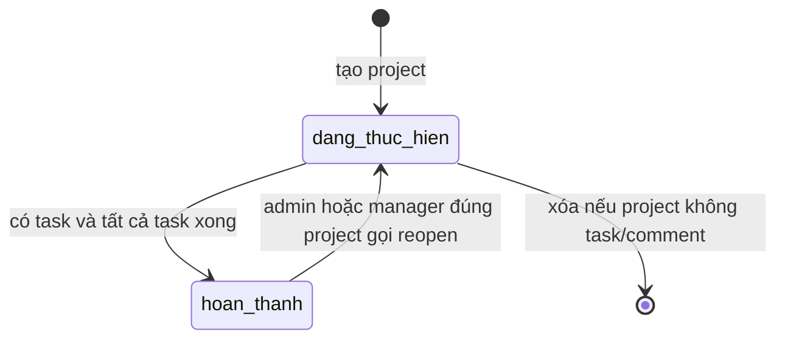
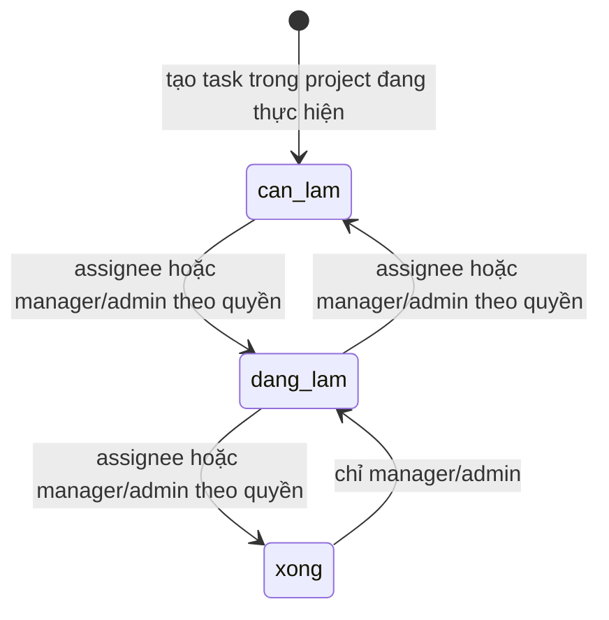

# Phân tích domain Dự án / Task / Thành viên

> Đối chiếu với code trong checkout `develop` ngày 09/11/2026. Bảng dưới mô tả contract hiện hành; mục “Cần chủ nghiệp vụ quyết định” là câu hỏi, không phải policy đã duyệt.

## Thuật ngữ và chủ thể

- **Project manager**: employee ở `projects.manager_id`; cần đồng thời có user role `manager` để các thao tác quản trị project được cho phép.
- **Project member**: dòng `project_members`; project manager được tự thêm vào membership khi tạo project.
- **Assignee**: employee được giao task; ở luồng API phải là member đang làm việc của project.
- **Task**: `can_lam` → `dang_lam` → `xong`, kèm deadline ngày/giờ, priority và assignee.

Nguồn: `schema.prisma: projects/project_members/tasks`; `projectController.createProject`; `taskController.validateTask/createTask`; `taskDetailsController.updateTaskDetails`.

## Invariants và bằng chứng hiện hành

1. **Ngày project:** `start_date <= end_date`; project mới không thể kết thúc trước ngày hiện tại. Nguồn: `projectController.validateProject`.
2. **Ngày task:** `project.start_date <= task.due_date <= project.end_date` khi tạo/sửa task; đổi khoảng project trả 409 nếu deadline nhỏ nhất/lớn nhất nằm ngoài khoảng mới. Nguồn: `utils/taskRules.dueDateError`, `taskController.createTask`, `taskDetailsController.updateTaskDetails`, `projectController.updateProject`.
3. **Assignee:** phải là member project và employee đang làm việc ở create/reassign. Nguồn: `taskController.createTask`, `taskDetailsController.updateTaskDetails`.
4. **Quyền quản trị project:** admin hoặc tài khoản role `manager` có `employee_id === projects.manager_id`; membership không tự cấp quyền sửa project/task. Nguồn: `projectController.canManageProject/loadManagedProject`.
5. **Phạm vi đọc:** admin xem mọi project; member xem project mình tham gia; role manager xem project mình quản lý hoặc tham gia. Task detail/list được kiểm tra quyền project. Nguồn: `projectController.listProjects/getProject`, `taskController.listProjectTasks/listMyTasks`, `taskDetailsController.getTaskDetails`.
6. **Hoàn tất project:** phải có ít nhất một task và mọi task phải `xong`; project hoàn thành chặn tạo/sửa/đổi trạng thái task. Nguồn: `projectController.completeProject`, `taskController`, `taskDetailsController`, `taskActionController`.
7. **Trạng thái task:** chỉ chuyển cột kề; employee được giao chỉ đi theo các bước cho phép, manager đúng project/Admin được đổi trạng thái qua bước kề. Cập nhật có điều kiện trạng thái cũ để tránh ghi đè cạnh tranh. Nguồn: `utils/taskRules.getAllowedMoves`, `taskActionController.changeTaskStatus`.
8. **Thành viên:** không thể bớt project manager; không thể bớt member còn task chưa hoàn tất. Nguồn: `memberController.removeMember`.
9. **Xóa project:** chỉ xóa khi không có task và không có project comment; transaction xóa DB xong mới dọn thư mục attachment đúng project. Nguồn: `projectController.createDeleteProjectHandler`, `services/attachmentStorage.js`.
10. **Comment/attachment trên project hoàn tất:** comment vẫn được tạo bởi người có quyền; upload/delete attachment mới bị chặn. Tạo/sửa/status task bị chặn. Nguồn: `projectCommentController`, `commentController`, `commentAccess.js`, `attachmentRoutes.js`, task controllers.

## Sơ đồ trạng thái

`completeProject` yêu cầu ít nhất một task và tất cả đã xong. `reopenProject` hiện cho admin/manager đúng project mở lại về `dang_thuc_hien`, không yêu cầu lý do và không có audit event chuyên biệt.

## Ma trận quyền theo API

| Hành động | Employee là member | Manager đúng `manager_id` | Admin | Người không thuộc project |
|---|---|---|---|---|
| Xem project/task trong project | Được | Được | Được | 403 |
| Xem “task của tôi” | Chỉ task được giao cho mình | Chỉ task được giao cho mình, ngoài project được quản lý có thể đọc thêm qua project routes | Task được giao cho mình ở `/mine`; mọi project qua project APIs | Không có task ngoài project/member scope |
| Đổi trạng thái task | Task được giao, theo bước cho phép | Task trong project, chỉ bước kề | Task trong mọi project, chỉ bước kề | 403 |
| Tạo/sửa task, quản lý member | Không | Được trong project mình quản lý | Được | 403 |
| Sửa/xóa/complete/reopen project | Không | Được trong project mình quản lý | Được | 403 |
| Bình luận project/task | Member được; project manager cũng được theo endpoint | Manager đúng project hoặc member | Được | 403 |
| Upload/delete attachment mới | Theo quyền project và trạng thái project | Theo quyền project và trạng thái project | Được khi project chưa hoàn thành | Bị chặn; project hoàn thành cũng chặn ghi attachment |

Nguồn: `projectRoutes.js`, `taskRoutes.js`, `projectController.js`, `taskAccess.js`, `memberController.js`, `commentAccess.js`, `attachmentRoutes.js`. Chú ý `role=manager` không cho quyền quản lý mọi project.

## Rủi ro dữ liệu/contract

1. **Assignee-member chỉ kiểm tra ở API:** schema có FK assignee tới employee nhưng chưa có composite FK bảo đảm assignee thuộc đúng `project_id`. Script/import khác có thể phá invariant nếu không gọi cùng validation.
2. **Membership không lưu lịch sử:** `removeMember` xóa dòng membership; không có `joined_at/left_at` đủ để tái dựng quyền theo thời gian.
3. **Offboarding không tự bàn giao:** status nghỉ việc làm token mất hiệu lực, nhưng task và membership vẫn tồn tại. Manager/Admin cần giao lại task; API chặn xóa member nếu task còn chưa xong.
4. **Đổi phòng không đổi project:** project membership và assignee không tự chuyển theo phòng ban. Bulk department transfer không chạy rà soát project/task.
5. **Manager role có thể lệch với project manager:** permission kiểm tra cả role `manager` lẫn `manager_id`. Nếu role bị hạ nhưng project vẫn trỏ tới employee đó, người này mất quyền quản lý cho đến khi role được xử lý.
6. **Hoàn tất/mở lại không có audit policy:** status được cập nhật nhưng không lưu người/lý do qua một bảng audit riêng.

## Câu hỏi cần chủ nghiệp vụ quyết định

1. Khi chuyển phòng hoặc nghỉ việc, membership/task cũ giữ nguyên, giao lại hay thu hồi quyền đọc? Ai chịu trách nhiệm và khi nào?
2. Có cho task chạy cuối tuần/ngày lễ không? Quy tắc lặp hiện bỏ cuối tuần; task không lặp vẫn có thể đặt cuối tuần.
3. Có cần lý do/người/thời điểm khi complete/reopen project không?
4. Có cần lưu lịch sử member khi bớt người khỏi project không?
5. Manager phòng ban và project manager có cần là cùng một vai trò/quy trình bổ nhiệm hay chỉ là hai quan hệ độc lập?

## Nguồn code chính

- `backend/prisma/schema.prisma`: `projects`, `project_members`, `tasks`.
- `backend/src/controllers/projectController.js`, `taskController.js`, `taskDetailsController.js`, `taskActionController.js`, `memberController.js`.
- `backend/src/utils/taskRules.js`, `taskAccess.js`, `commentAccess.js`.
- `backend/src/routes/projectRoutes.js`, `taskRoutes.js`, `attachmentRoutes.js`.
- Test contract: `backend/tests/project-task.integration.test.js`, `backend/tests/issue95.integration.test.js`.
