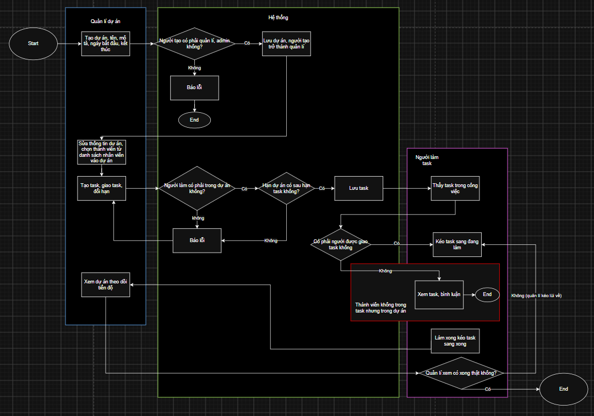
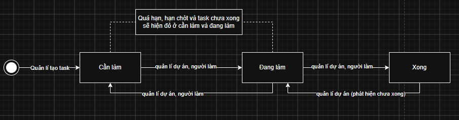

# TÀI LIỆU ĐẶC TẢ YÊU CẦU NGHIỆP VỤ (BRD)
## PHÂN HỆ QUẢN LÝ CÔNG VIỆC & GIAO DIỆN CHUNG

> Tài liệu đặc tả yêu cầu nghiệp vụ cho phân hệ Quản lý công việc (Dự án, Task, Bảng Kanban) và Giao diện chung.

---

## 1. Quy trình nghiệp vụ

### 1.1 Quy trình giao việc và quản lý dự án
Sơ đồ quy trình tổng thể:

* **Khởi tạo dự án:** Quản lý hoặc Admin tạo dự án mới gồm: Mã dự án (duy nhất), Tên dự án, Mô tả, Ngày bắt đầu, Ngày kết thúc. Người tạo tự động trở thành Quản lý dự án đồng thời là thành viên đầu tiên của dự án. Trạng thái ban đầu là `Đang thực hiện`.
* **Quản lý thành viên:** Quản lý dự án chọn nhân viên đang làm việc để thêm vào dự án.
* **Tạo và giao task:** Quản lý dự án tạo task (Tiêu đề, Người làm task, Hạn chót, Mức ưu tiên: Thấp / Trung bình / Cao, Mô tả).
  * *Ràng buộc:* Người làm task phải là thành viên dự án (Quản lý dự án có thể tự giao việc cho mình). Hạn chót của task không được sau ngày kết thúc dự án (trùng ngày vẫn hợp lệ).
* **Thực hiện và nghiệm thu:** Người làm task thấy công việc ở trang "Việc của tôi" và trong dự án, chuyển task sang `Đang làm`, khi hoàn tất chuyển sang `Xong`. Quản lý dự án xem xét thực tế: nếu chưa đạt thì kéo lùi về `Đang làm`, nếu đạt thì giữ nguyên.
* **Đóng và mở lại dự án:** Khi dự án có ít nhất 1 task và tất cả task đã `Xong`, Quản lý dự án hoặc Admin có thể chuyển dự án sang `Hoàn thành`. Dự án `Hoàn thành` bị khóa (chi tiết ở US_02). Muốn tiếp tục xử lý công việc thì dùng chức năng **Mở lại dự án**.

---

### 1.2 Vòng đời trạng thái task (Bảng Kanban)
Sơ đồ luân chuyển trạng thái công việc:

* **Vòng đời chuẩn:** `Cần làm` (khi tạo mới) ➔ `Đang làm` ➔ `Xong`.
* **Bước kề nhau:** Chỉ được kéo thả giữa hai cột kề nhau (`Cần làm` ⬄ `Đang làm` ⬄ `Xong`), không được nhảy cóc từ `Cần làm` sang `Xong`.
* **Kéo lùi:** `Đang làm` ➔ `Cần làm` khi công việc tạm hoãn hoặc vướng mắc. `Xong` ➔ `Đang làm` khi nghiệm thu thực tế chưa đạt. Ai được kéo: xem bảng 2.1 và US_10.
* **Cảnh báo quá hạn:** Hệ thống so sánh ngày hiện tại với hạn chót của task mỗi khi hiển thị. Khi ngày hiện tại đã vượt qua hạn chót mà task chưa `Xong`, task được tô đỏ ở Bảng Kanban, trang "Việc của tôi" và danh sách task. Đúng ngày hạn chót chưa bị tô đỏ.
* **Cảnh báo sắp hạn:** Hệ thống so sánh ngày hiện tại với ngày hạn của task. Nếu task chưa `Xong`, chưa quá hạn và còn từ 0 đến 3 ngày lịch đến hạn chót (kể cả đúng ngày hạn chót), task được tô vàng ở Bảng Kanban, trang "Việc của tôi" và danh sách task. Task `Xong` không hiện màu cảnh báo.

---

## 2. Phân quyền và Danh sách User Story

### 2.1 Bảng phân quyền
Hệ thống tự kiểm tra quyền theo bảng dưới đây; thao tác ngoài phạm vi cho phép sẽ bị từ chối.

| Chức năng | Admin | Quản lý dự án | Người làm task | Thành viên khác |
| :--- | :---: | :---: | :---: | :---: |
| Tạo dự án mới (*) | Có | Có | Không | Không |
| Sửa thông tin dự án, hoàn thành / mở lại dự án | Có | Có | Không | Không |
| Thêm / bớt thành viên dự án | Có | Có | Không | Không |
| Tạo task, sửa task (giao lại, đổi hạn, ưu tiên) | Có | Có | Không | Không |
| Xem chi tiết dự án, tiến độ và task | Có (mọi dự án) | Có | Có | Có |
| Kéo thả task giữa 2 cột kề nhau | Có | Có | Có (chỉ task của mình) | Không |
| Kéo lùi task từ Xong về Đang làm | Có | Có | Không | Không |
| Viết bình luận trong task | Có | Có | Có | Có |

*Ghi chú:*
* (*) Dòng "Tạo dự án mới" áp dụng cho tài khoản có vai trò Quản lý hoặc Admin, vì lúc tạo chưa có dự án nào.
* Quản lý dự án mặc định là thành viên của dự án. Một người có thể giữ nhiều vai trò cùng lúc (ví dụ Quản lý dự án tự giao việc cho mình) và khi đó có quyền của tất cả vai trò đó.
* Người không thuộc dự án (trừ Admin) không có quyền nào trong bảng trên.

---

### 2.2 Danh sách User Story

#### NHÓM 1: LÀM VIỆC VỚI DỰ ÁN

##### US_01: Tạo dự án mới
- **Phân loại:** Bắt buộc
- **Là** 1 Quản lý hoặc Admin, **tôi muốn** tạo dự án mới với mã dự án, tên, mô tả, ngày bắt đầu, ngày kết thúc **để** tổ chức công việc cho nhóm.
* **Tiêu chí:**
  - **Khi** nhập đủ mã dự án (không trùng), tên dự án, ngày bắt đầu, ngày kết thúc (không trước ngày bắt đầu), hệ thống tạo dự án ở trạng thái `Đang thực hiện`, gán người tạo làm Quản lý dự án và thành viên đầu tiên.
  - **Khi** nhập thiếu thông tin bắt buộc, trùng mã dự án hoặc ngày kết thúc trước ngày bắt đầu, hệ thống từ chối tạo và báo lỗi.

##### US_02: Sửa thông tin, hoàn thành và mở lại dự án
- **Phân loại:** Bắt buộc
- **Là** 1 Quản lý dự án hoặc Admin, **tôi muốn** sửa thông tin dự án, chuyển dự án sang Hoàn thành hoặc mở lại dự án **để** quản lý vòng đời dự án chặt chẽ.
* **Tiêu chí:**
  - **Khi** cập nhật thông tin dự án (tên, mô tả, ngày bắt đầu, ngày kết thúc) hợp lệ, hệ thống lưu thông tin mới.
  - **Khi** chuyển sang `Hoàn thành` mà dự án chưa có task nào hoặc còn task chưa `Xong`, hệ thống từ chối và báo lỗi (*"Dự án chưa có task nào để hoàn thành"* hoặc *"Vẫn còn task chưa hoàn thành"*).
  - **Khi** chuyển sang `Hoàn thành` và dự án có ít nhất 1 task, tất cả đã `Xong`, hệ thống cập nhật trạng thái và khóa dự án: không tạo task, không sửa hoặc giao lại task, không kéo thả task. Xem dự án và bình luận vẫn được.
  - **Khi** Quản lý dự án hoặc Admin chọn **Mở lại dự án**, hệ thống đưa dự án về `Đang thực hiện` và mở khóa.

##### US_03: Thêm và bớt thành viên trong dự án
- **Phân loại:** Bắt buộc
- **Là** 1 Quản lý dự án hoặc Admin, **tôi muốn** thêm hoặc bớt thành viên dự án **để** phân bổ nhân sự phù hợp.
* **Tiêu chí:**
  - **Khi** chọn thêm thành viên, hệ thống chỉ hiển thị danh sách nhân viên đang làm việc để lựa chọn.
  - **Khi** bớt một thành viên mà người này còn task chưa `Xong`, hệ thống từ chối và báo lỗi: *"Còn [N] task chưa xong, hãy giao lại trước khi bớt thành viên"*. Nếu không còn task chưa `Xong`, hệ thống xóa thành viên khỏi dự án.

##### US_04: Xem dự án, tiến độ và giới hạn truy cập
- **Phân loại:** Bắt buộc
- **Là** 1 thành viên dự án, **tôi muốn** xem danh sách dự án của tôi và trang chi tiết dự án có tiến độ **để** nắm bắt tình hình triển khai.
* **Tiêu chí:**
  - **Khi** xem danh sách dự án, Nhân viên chỉ thấy các dự án mình tham gia, Admin thấy toàn bộ dự án.
  - **Khi** người không thuộc dự án (trừ Admin) truy cập trực tiếp vào dự án, danh sách task, chi tiết task hoặc bình luận của dự án đó, hệ thống từ chối truy cập và báo lỗi.
  - **Khi** vào trang chi tiết dự án, hệ thống hiển thị thông tin dự án, danh sách thành viên, danh sách task và tiến độ dạng **[Số task đã xong] / [Tổng số task]** (ví dụ `1/1 task đã xong - 100%`).

---

#### NHÓM 2: LÀM VIỆC VỚI TASK TRONG DỰ ÁN

##### US_05: Tạo task trong dự án
- **Phân loại:** Bắt buộc
- **Là** 1 Quản lý dự án hoặc Admin, **tôi muốn** tạo task với tiêu đề, người làm task, hạn chót, mức ưu tiên (Thấp / Trung bình / Cao) và mô tả **để** giao việc cho nhân viên.
* **Tiêu chí:**
  - **Khi** dự án đang ở trạng thái `Hoàn thành`, hệ thống chặn tạo task mới.
  - **Khi** người làm task không phải thành viên dự án, hoặc hạn chót sau ngày kết thúc dự án, hệ thống từ chối và báo lỗi.
  - **Khi** nhập đầy đủ thông tin hợp lệ, hệ thống tạo task mới ở trạng thái `Cần làm`.

##### US_06: Sửa task và giao lại task
- **Phân loại:** Bắt buộc
- **Là** 1 Quản lý dự án hoặc Admin, **tôi muốn** sửa thông tin task, đổi hạn chót hoặc giao lại task cho người khác **để** điều chỉnh kế hoạch phù hợp với thực tế.
* **Tiêu chí:**
  - **Khi** dự án đang ở trạng thái `Hoàn thành`, hệ thống chặn mọi thao tác sửa hoặc giao lại task.
  - **Khi** giao lại task, người làm mới phải là thành viên dự án. Hệ thống cập nhật người phụ trách và task xuất hiện ở trang "Việc của tôi" của người đó.
  - **Khi** đổi hạn chót, hạn mới không được sau ngày kết thúc dự án, nếu sai hệ thống báo lỗi. Sửa tiêu đề, mô tả hoặc mức ưu tiên hợp lệ thì hệ thống lưu thay đổi.

##### US_07: Xem chi tiết task
- **Phân loại:** Bắt buộc
- **Là** 1 thành viên trong dự án, **tôi muốn** xem chi tiết task **để** nắm rõ yêu cầu công việc, người phụ trách, mức ưu tiên và hạn chót.
* **Tiêu chí:**
  - **Khi** thành viên trong dự án hoặc Admin mở task, hệ thống hiển thị đầy đủ: Tiêu đề, Mô tả, Người làm task, Hạn chót, Mức ưu tiên, Trạng thái và Danh sách bình luận.

##### US_08: Bình luận trong task
- **Phân loại:** Bắt buộc
- **Là** 1 thành viên trong dự án, **tôi muốn** bình luận trong task **để** trao đổi công việc với đồng nghiệp.
* **Tiêu chí:**
  - **Khi** thành viên trong dự án hoặc Admin gửi bình luận, hệ thống lưu và hiển thị ngay nội dung kèm tên người gửi và thời gian gửi.
  - **Khi** bình luận đã gửi, hệ thống không có chức năng sửa hoặc xóa bình luận.

##### US_09: Trang Việc của tôi và cảnh báo quá hạn
- **Phân loại:** Bắt buộc
- **Là** 1 nhân viên, **tôi muốn** có trang "Việc của tôi" liệt kê các task được giao cho mình và thấy rõ task quá hạn **để** chủ động ưu tiên xử lý.
* **Tiêu chí:**
  - **Khi** vào trang "Việc của tôi", hệ thống chỉ liệt kê các task mà tôi là Người làm task, trên tất cả các dự án tôi tham gia.
  - **Khi** hiển thị task, hệ thống tô đỏ và ghi nhãn “Quá hạn” cho task quá hạn, tô vàng và ghi “Sắp hạn” cho task sắp hạn, task còn lại chưa Xong hiện màu xanh.
  - **Khi** xem Việc của tôi, hệ thống xếp task quá hạn lên đầu; các task còn lại xếp theo hạn chót gần đến xa (mặc định) hoặc theo mức ưu tiên cao đến thấp nếu tôi chọn.

---

#### NHÓM 3: BẢNG KANBAN

##### US_10: Kéo thả đổi trạng thái task trên Bảng Kanban
- **Phân loại:** Bắt buộc
- **Là** 1 Quản lý dự án, Admin hoặc Người làm task, **tôi muốn** kéo thả task giữa các cột trên Bảng Kanban của dự án **để** cập nhật tiến độ trực quan.
* **Tiêu chí:**
  - **Khi** dự án đang ở trạng thái `Hoàn thành`, hệ thống khóa Bảng Kanban và từ chối mọi thao tác kéo thả.
  - **Khi** Người làm task kéo task **do chính mình phụ trách** giữa hai cột kề nhau (`Cần làm` ➔ `Đang làm`, `Đang làm` ➔ `Xong`, hoặc kéo lùi `Đang làm` ➔ `Cần làm`), hệ thống cập nhật trạng thái mới.
  - **Khi** Người làm task hoặc thành viên khác kéo task **do người khác phụ trách**, kéo nhảy cóc (`Cần làm` ➔ `Xong`), hoặc Người làm task kéo lùi từ `Xong` ➔ `Đang làm`, hệ thống từ chối và trả thẻ về vị trí cũ.
  - **Khi** Quản lý dự án hoặc Admin kéo task bất kỳ giữa hai cột kề nhau (kể cả kéo lùi `Xong` ➔ `Đang làm` khi nghiệm thu chưa đạt), hệ thống cập nhật trạng thái mới.

---

#### NHÓM 4: GIAO DIỆN CHUNG

##### US_11: Menu điều hướng theo vai trò (cộng dồn)
- **Phân loại:** Bắt buộc
- **Là** 1 người dùng, **tôi muốn** thanh menu chỉ hiển thị các mục phù hợp với vai trò của mình **để** điều hướng nhanh và dùng đúng quyền hạn.
* **Tiêu chí:**
  - **Khi** Nhân viên đăng nhập, menu hiển thị: Trang chủ, Dự án của tôi, Việc của tôi, Đơn xin nghỉ phép, Bảng công cá nhân.
  - **Khi** Quản lý đăng nhập, menu có toàn bộ mục của Nhân viên và thêm: Tạo và điều hành dự án, Duyệt đơn nghỉ phép.
  - **Khi** Admin đăng nhập, menu có toàn bộ mục của Quản lý và thêm: Quản lý nhân viên, Quản lý phòng ban, Bảng công toàn công ty.

##### US_12: Trang chủ hiển thị số liệu tổng hợp
- **Phân loại:** Bắt buộc
- **Là** 1 người dùng, **tôi muốn** xem số liệu tóm tắt trên Trang chủ **để** nắm nhanh tình hình công việc và chấm công của bản thân.
* **Tiêu chí:**
  - **Khi** vào Trang chủ, hệ thống hiển thị nút Vào ca / Ra ca, số ngày công trong tháng và bảng công.
  - **Khi** vào Trang chủ, hệ thống hiển thị khối “Việc của tôi” gồm 3 cột Cần làm / Đang làm / Xong, mỗi cột kèm số task, kèm tổng số task quá hạn; màu và thứ tự theo US_09.
  - **Khi** kéo thả hoặc bấm vào thẻ task trong khối này, hệ thống áp dụng quy tắc của US_10 và mở chi tiết theo US_07.
  - **Khi** Quản lý hoặc Admin vào Trang chủ, hệ thống hiển thị thêm tổng số dự án đang quản lý và số đơn nghỉ phép đang chờ duyệt.

---

#### NHÓM 5: CHỨC NĂNG LÀM THÊM

##### US_13: Xóa dự án rỗng
- **Phân loại:** Làm thêm
- **Là** 1 Quản lý dự án hoặc Admin, **tôi muốn** xóa dự án rỗng không còn sử dụng **để** dọn dẹp danh sách dự án.
* **Tiêu chí:**
  - **Khi** dự án còn task (ở bất kỳ trạng thái nào), hệ thống từ chối xóa và báo lỗi. Khi dự án không có task nào, hệ thống cho phép xóa.

##### US_14: Biểu đồ thống kê tiến độ trên Trang chủ
- **Phân loại:** Làm thêm
- **Là** 1 Quản lý dự án, **tôi muốn** xem biểu đồ tỷ lệ hoàn thành công việc theo thời gian **để** theo dõi trực quan năng suất của dự án.

---

## 3. Tình huống ngoại lệ và Bảng truy vết

### 3.1 Tình huống ngoại lệ

* **Tình huống 1: Người làm task nghỉ việc**
  - *Cách xử lý:* Hệ thống giữ nguyên task ở trạng thái hiện tại. Quản lý dự án dùng chức năng sửa task (US_06) để giao lại cho thành viên khác trong dự án.
  - *Lý do:* Bảo đảm dữ liệu lịch sử công việc và không làm gián đoạn tiến độ chung.

* **Tình huống 2: Bớt thành viên khi còn task chưa xong**
  - *Cách xử lý:* Hệ thống chặn và báo: *"Còn [N] task chưa xong, hãy giao lại trước khi bớt thành viên"*. Quản lý dự án phải giao lại các task đó trước khi bớt thành viên.
  - *Lý do:* Tránh task bị bỏ trống người phụ trách.

* **Tình huống 3: Muốn đổi trạng thái hoặc sửa task khi dự án đã "Hoàn thành"**
  - *Cách xử lý:* Hệ thống chặn kéo thả, sửa và tạo task. Nếu cần xử lý tiếp, Quản lý dự án hoặc Admin dùng **Mở lại dự án** (US_02).
  - *Lý do:* Tránh dự án mang nhãn "Hoàn thành" nhưng bên trong có task đang làm dở hoặc bị kéo lùi.

---

### 3.2 Bảng truy vết

| # | Quy tắc nghiệp vụ cốt lõi | User Story đáp ứng |
|---|---|:---:|
| 1 | Chỉ Quản lý hoặc Admin tạo được dự án, người tạo trở thành Quản lý dự án (đồng thời là thành viên) | US_01 |
| 2 | Thành viên dự án chọn từ danh sách nhân viên đang làm việc | US_03 |
| 3 | Chỉ giao task cho thành viên của dự án (Quản lý dự án có thể tự giao cho mình) | US_05, US_06 |
| 4 | Hạn chót task không được sau ngày kết thúc dự án (trùng ngày vẫn hợp lệ) | US_05, US_06 |
| 5 | Chỉ Quản lý dự án và Admin sửa dự án, thêm/bớt thành viên, tạo/sửa/giao task | US_02, US_03, US_05, US_06 |
| 6 | Đổi trạng thái theo quy tắc kề nhau; Người làm task chỉ đổi task của mình, chỉ Quản lý dự án và Admin kéo lùi từ Xong | US_10 |
| 7 | Task quá hạn (ngày hiện tại > hạn chót và chưa Xong) tô đỏ ở mọi nơi | US_09, US_12 |
| 8 | Bình luận trong task không có chức năng sửa hoặc xóa | US_08 |
| 9 | Người ngoài dự án không thấy và không truy cập được dự án, task, bình luận (trừ Admin) | US_04 |
| 10 | Nhân viên chỉ thấy các dự án mình tham gia | US_04 |
| 11 | Task sắp hạn (còn 0–3 ngày lịch, chưa Xong) hiện màu vàng; task Xong không hiện màu cảnh báo | US_09, US_12 |